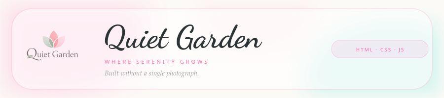

*A landing page for a flower shop that does not exist, built without a single photograph.*

**[Open the page](https://bytiagodev.github.io/quiet-garden-landing-page/)**

 

### the constraint

I wanted to build a landing page for a fictional flower shop called Quiet Garden, and I did not want stock photos anywhere in it. Instead of hunting for the right Unsplash images, I used watercolour illustrations for every visual on the page: the logo, the storefront, the products, the journal entries, even the founder's signature. The goal was a site that reads like a painted journal rather than a template, using HTML and CSS to do the work.

### making paint stick to a web page

Dropping an illustration onto a coloured card gives you a sticker with a hard edge. `mix-blend-mode: multiply` gives you paint. The white in the illustration drops away and the card's colour wash comes through the brushwork, so the image looks applied to the surface rather than placed on top of it. A fixed pseudo-element carries a handmade paper texture across the whole page at 20% opacity, which ties every section to the same sheet.

### what the CSS is carrying

**Blob shapes.** The product cards use a multi-value border-radius for an organic, uneven outline. No SVG, no clip-path, just:

`border-radius: 40% 60% 70% 30% / 50% 40% 60% 50%;`

**Watercolour reveals.** Elements start blurred, shifted down and slightly scaled back. An IntersectionObserver adds a class as they enter the viewport, and CSS clears the blur over 1.5s so they spread into focus rather than fade in. The hidden state only exists while scripts run, so with JavaScript off the whole page is there, and with reduced motion on everything appears at once.

**The hero wash.** Two radial gradients, pink and teal, sit on a layer behind the hero, and a mask fades that layer out at the bottom, so the colour soaks away into the paper instead of stopping at a line.

**Journal cards.** The blog images sit in white padded cards rotated a couple of degrees off true. A `::before` pseudo-element makes a strip of pink or teal tape across the top edge.

**The about section.** That card is rotated by -0.8 degrees, so it rests on the page like paper on a desk instead of snapping to the grid.

### what it is made of

Plain HTML and CSS, with about thirty-five lines of JavaScript for the reveals and the newsletter form. The illustrations are WebP files sized to the layout and the paper texture is served from the repo, so the only thing loaded from elsewhere is one Google Font for the decorative headings.

 

*A quiet corner where the light hits the leaves.*

More work, and the projects that came after this one: [bytiago.com](https://bytiago.com/en/)

